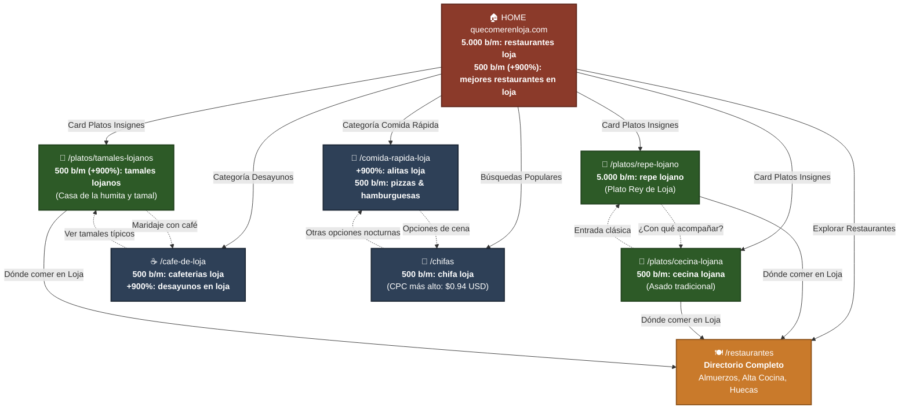

# 🗺️ MAPA DE ARQUITECTURA SEO Y POSICIONAMIENTO — quecomerenloja.com
## Basado en 89 Palabras Clave Reales de Google Ads (Keyword Planner)

---

## 📊 1. DIAGRAMA GLOBAL DE ARQUITECTURA Y FLUJO DE TRÁFICO

---

## 📋 2. MATRIZ DE VOLUMEN REAL Y PÁGINAS DESTINO

| Nivel | URL Destino | Keywords Principales | Búsquedas/Mes | Intención de Búsqueda | Estado |
| :--- | :--- | :--- | :--- | :--- | :--- |
| **Pilar** | `/` (Home) | `restaurantes loja`, `donde comer en loja`, `lugares para comer en loja` | **5.000 / +900%** | General, orientación, descubrimiento | ✅ **Implementado** |
| **Satélite 1** | `/platos/repe-lojano` | `repe lojano`, `repe blanco`, `comida tipica loja` | **5.000** | Transaccional / Informativo (Plato insignia) | ✅ **Implementado** |
| **Satélite 2** | `/platos/cecina-lojana` | `cecina lojana`, `cecina loja`, `cecina con yuca` | **500** | Tradición, asados, dónde comer cecina | ⏳ *En proceso* |
| **Satélite 3** | `/platos/tamales-lojanos` | `tamales lojanos`, `casa de la humita y el tamal lojano`, `humita y tamal` | **500 (+900%)** | Desayunos, tradición, meriendas | ⏳ *En proceso* |
| **Cluster Café**| `/cafe-de-loja` | `cafeterias loja`, `cafeterias en loja`, `desayunos en loja` | **500 (+900%)** | Café de altura, tertulia, desayuno | ⏳ *Por optimizar* |
| **Cluster Noche**| `/comida-rapida-loja` | `alitas loja`, `pizzas en loja`, `hamburguesas loja` | **1.500 (+900%)** | Comida rápida, salidas en grupo, noche | ⏳ *Por crear* |
| **Cluster CPC** | `/chifas` | `chifa loja`, `mejores chifas loja` | **500 ($0.94 CPC)** | Almuerzos abundantes, cena en familia | ⏳ *Por crear* |

---

## 🎯 3. ESTRATEGIA DE ENLAZADO INTERNO (LINK JUICE DISTRIBUTION)

1. **La Home como Distribuidor de Autoridad:**
   - La Home contiene enlaces directos en H2/cards hacia los 3 platos insignia (`repe`, `cecina`, `tamales`) y hacia los 3 clusters de categoría (`cafeterías/desayunos`, `comida rápida`, `chifas`).
2. **Las Páginas Satélites canalizan al Directorio:**
   - Cada página de plato típico incluye un bloque `"Dónde comer este plato hoy"` que filtra y muestra restaurantes con fichas directas, llevando tráfico al negocio local.
3. **Páginas Hermanas Cruzadas:**
   - Enlaces contextuales entre `repe` y `cecina` (el combo clásico lojano).
   - Enlaces contextuales entre `tamales` y `cafeterías`.
